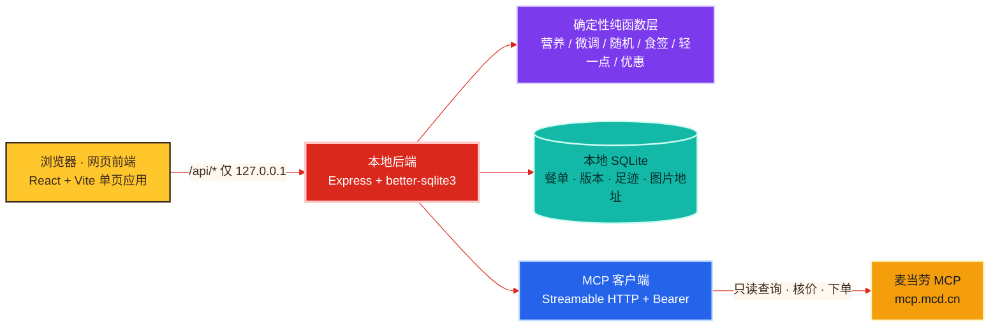

# Mac-Buddy · 麦麦搭子

<div align="center">

**Mac-Buddy × 麦当劳 MCP × React × Express × SQLite**

懂你口味的麦当劳点餐助手 —— 记得你的老样子，也懂你想换换口味。
_Your taste. Your Buddy._

<p>
  
  
  
  
  
  
</p>


<p>
  <b>参赛名称</b>：Mac-Buddy 麦麦搭子——懂你口味的点餐助手　|　<b>仓库</b>：mac-Buddy　|　<b>Skill</b>：mcd-buddy　|　<b>定位</b>：非官方产品
</p>

</div>

基于**麦当劳 MCP（McDonald's Capability Platform）**的独立开发者参赛作品。

> **这是非官方产品**，与麦当劳中国无隶属或授权关系。餐品、价格、供应状态一律以麦当劳官方渠道的实时结果为准。

**导航**：[为什么做这个](#为什么做这个) · [功能一览](#功能一览) · [使用示例](#使用示例) · [架构](#架构) · [业务流程](#业务流程) · [快速开始](#快速开始) · [MCP 接入](#mcp-接入) · [技术栈与目录](#技术栈与目录结构) · [验证与限制](#验证与限制) · [开发记录与许可](#开发记录与许可)

---

## 为什么做这个

点麦当劳最费神的不是「想吃什么」，而是「每次都要重新点一遍」。


Mac-Buddy 把「我常点的那一套」存成本地可版本化的**老样子**，然后围绕它做几件事：

- 想照旧 → 一键复用；
- 想换一点 → 只改一处，锁住不想动的；
- 没想法 → 随机抽一份 / 抽今日一签；
- 想心里有数 → 看这一餐的能量与蛋白质，做「能量少一点 / 蛋白多一点 / 钠少一点」；
- 想省一点 → 看看当前门店这一餐有没有可用的券（金额来自实际核价）；
- 要下单 → 先「看一眼」再确认。

**核心承诺：不替你做决定。** 冲突时只说明原因并给出可放宽项，绝不自动突破你设的约束。

---


## 功能一览

| 功能 | 一句话说明 | 主要数据来源 | 状态 |
| --- | --- | --- | --- |
| 老样子（模板与版本） | 保存固定餐单，改动生成**不可变新版本**，可对比、可回退 | 本地 SQLite + `order-list` 导入 | 已实现 |
| 今天微微调 | 默认最多改 **1 处**，锁定项不动，冲突时只说明原因 | `query-meals` / `query-meal-detail` | 已实现 |
| 随机来一份 | 候选在本地**确定性**构建，「换一个」只推进种子 | `query-meals` / `calculate-price` | 已实现 |
| 今日食签 | 启发式打分（**非运势**），当日结果稳定 | `query-meals` / `calculate-price` | 已实现 |
| 这一餐的能量卡 | 能量 / 蛋白质等，按官方营养资料口径计算 | `list-nutrition-foods` | 已实现 |
| 老样子轻一点 | 能量少一点 / 蛋白多一点 / 钠少一点 | `list-nutrition-foods` 等 | 已实现 |
| 同样吃，看看优惠 | 同门店同商品只挂券，金额来自**实际核价** | `query-store-coupons` / `calculate-price` | 已实现 |
| 看图轻松点 | 用 MCP 返回的官方 https 图片，失败降级为「示意图」 | `query-meals` / `query-meal-detail` | 已实现 |
| 下单前看一眼 | 一屏核对门店 / 商品 / 金额 / 差别后由用户确认 | `calculate-price` / `create-order` | 已实现（真实下单未验证） |
| 我的口味 / 饮食足迹 | 只统计已完成订单，每条结论可解释、可改正 | `order-list` | 已实现 |
| 演示模式 | 完全离线、虚构数据、不产生任何真实订单 | 内置虚构数据 | 模拟演示 |
| 预约下单 / 多券叠加寻优 / 会员权益与积分 | 见 [验证与限制](#验证与限制) | — | 尚未实现 |

> 「状态」三档含义：**已实现**＝功能完成且逻辑可运行；**模拟演示**＝仅在演示模式下以虚构数据呈现；**尚未实现**＝未开发，请勿当成可用功能。

---

## 使用示例

**自然语言怎么用** —— 直接把想说的话打进「说人话」输入框：

| 你说的话 | 它会怎么做 |
| --- | --- |
| `还是老样子，饮料换成美式` | 只替换饮料槽位，其余保持老样子 |
| `主食别动，其他随便换一个` | 锁定主食，最多再改 1 处 |
| `别超过 40 块` | 作为预算约束参与方案生成，不满足就不给方案 |
| `不要香菜`（没有就没有） | 作为排除项；**不硬凑**，解析不出来会向你确认 |
| `再来一份中薯条` | 数量 +1，不静默去重 |
| `这一餐大概多少卡 / 蛋白质多少` | 按官方营养资料给出能量与蛋白质 |
| `能量少一点 / 蛋白多一点 / 钠少一点` | 给同类优先、跨类兜底的替换方案 |
| `同样吃，看看有没有优惠` | 只挂券不换商品，用实际核价给出省钱额 |
| `抽个签 / 今天吃什么` | 生成今日食签（启发式打分，不涉运势） |

更多示例见 [`examples/nl-instructions.md`](examples/nl-instructions.md)。

**典型流程**：`点一餐 → 选门店与就餐方式 → 生成方案 → 核价 → 下单前看一眼 → 确认下单`。
解析不出来会**向你确认**，而不是瞎改。

---

## 架构

后端是唯一持有 MCP Token 的一层；前端只做展示与交互，永远拿不到 Token。



这张图概括了核心分工：**前端负责交互，后端负责组织与持钥，纯函数层负责确定性计算，MCP 客户端负责对外连接**。
后端内部严格三层，详见 [`docs/architecture.md`](docs/architecture.md)：

1. **纯函数层**（`nutrition.ts` / `tweak.ts` / `randomPicker.ts` / `foodSign.ts` / `lighter.ts` / `coupons.ts` / …）：不调用 MCP、不读环境变量、不碰数据库，输入全部参数注入，**因此可以完全离线被单元测试覆盖**。
2. **编排层**（`generators.ts`）：唯一把真实 MCP 数据组装进纯函数的地方，负责菜单 / 营养 / 食签的缓存与演示 · 真实模式分流。
3. **I/O 层**（`service.ts` / `mcpClient.ts` / `routes.ts` / `db.ts`）：MCP 调用、SQLite 读写、HTTP 路由；**Token 只存在于这一层**。

---

## 业务流程

一次点餐从进入到下单，真正会走的链路如下：

```mermaid
%%{init: {"theme": "base", "themeVariables": {"fontFamily": "Inter, Microsoft YaHei, sans-serif", "background": "#FFFFFF", "primaryTextColor": "#3B2921", "primaryBorderColor": "#FFC72C", "lineColor": "#DA291C", "edgeLabelBackground": "#FFF8EE"}}}%%
flowchart LR
    A["1 进入网页<br/>点一餐 / 我的老样子 / 我的口味"]:::s1
    B["2 选门店与就餐方式"]:::s2
    C["3 拉取菜单与可售状态<br/>query-meals"]:::s3
    D["4 生成方案（纯函数 · 可复现）<br/>微微调 / 随机 / 食签 / 轻一点 / 优惠"]:::s4
    E["5 真实核价<br/>calculate-price"]:::s5
    F["6 下单前看一眼<br/>核对门店 · 商品 · 金额 · 差别"]:::s6
    G["7 确认下单<br/>create-order"]:::s7

    A --> B --> C --> D --> E --> F
    F -->|"确认下单"| G
    F -.->|"返回修改"| D

    classDef s1 fill:#FFC72C,stroke:#3B2921,color:#3B2921,stroke-width:2px;
    classDef s2 fill:#F97316,stroke:#FFEDD5,color:#111827,stroke-width:2px;
    classDef s3 fill:#14B8A6,stroke:#CCFBF1,color:#042F2E,stroke-width:2px;
    classDef s4 fill:#7C3AED,stroke:#DDD6FE,color:#FFFFFF,stroke-width:2px;
    classDef s5 fill:#2563EB,stroke:#BFDBFE,color:#FFFFFF,stroke-width:2px;
    classDef s6 fill:#F59E0B,stroke:#FEF3C7,color:#111827,stroke-width:2px;
    classDef s7 fill:#DA291C,stroke:#FECACA,color:#FFFFFF,stroke-width:3px;
```



要点：**只有用户点「确认下单」才会调用 `create-order`**；餐品 / 门店 / 就餐方式任何变化都会**重新核价并要求重新确认**；核价失败如实展示，不显示假金额。

---

## 快速开始

前置：**Node.js >= 20**。

### 方式 A · 演示模式（推荐先跑这个，不需要 Token）

```bash
npm install
npm run build
npm run demo          # 强制演示模式
# 打开 http://127.0.0.1:8787
```

一步到位脚本：`bash scripts/start-demo.sh`

演示模式使用**虚构**门店、菜单、营养表与优惠券，**不调用真实接口、不产生任何真实订单、不生成支付链接**，界面上所有演示来源都有「演示 / 示意图 / 演示数据」标记。详见 [`docs/demo.md`](docs/demo.md)。

### 方式 B · 真实模式（需要麦当劳 MCP Token）

```bash
cp .env.example apps/server/.env      # 填入 MCD_MCP_TOKEN=
npm run build && npm start            # 打开 http://127.0.0.1:8787
```

- Token 在 https://open.mcd.cn/mcp 申请；填入时**不要**加 `Bearer ` 前缀，后端会自动补。
- 也可用 `bash scripts/start-real.sh`（会先校验 `.env` 是否已配置）。
- 后端只监听 `127.0.0.1`，**请勿直接暴露到公网**。

### 开发模式

```bash
npm run dev     # 前端 http://127.0.0.1:5173（Vite） + 后端 http://127.0.0.1:8787
```

网页前端默认**运行即自动弹出浏览器**（开发模式打开 5173，生产模式打开 8787）。不想自动打开时，`NO_OPEN=1` 再启动。

### 安装为 Skill

Skill 位于 [`skills/mcd-buddy/`](skills/mcd-buddy/)，把整个目录复制到你的 skills 目录即可。
注意：**它不是纯提示词包**，依赖本仓库的本地后端，安装后仍需 `npm install` 并启动后端，详见 [`skills/mcd-buddy/SKILL.md`](skills/mcd-buddy/SKILL.md)。

---

## MCP 接入

- 传输协议：**Streamable HTTP**；服务地址 `https://mcp.mcd.cn`；鉴权 `Authorization: Bearer <token>`。
- 连接器配置示例（占位符，不含真实 Token）：[`mcp-config.example.json`](mcp-config.example.json)。
- 调用前一律先 `tools/list` 读取 `inputSchema`，**不凭工具名猜参数**。

**本项目实际调用的工具**：

| MCP 工具 | 用途 | 真实接口验证情况 |
| --- | --- | --- |
| `now-time-info` | 服务器时间 | 已验证 |
| `query-nearby-stores` | 附近 / 收藏门店 | 已验证 |
| `query-meals` | 当前门店菜单与可售状态（含 `image`） | 已验证 |
| `query-meal-detail` | 套餐组成 / 特制选项 / 单品图片 | 已验证 |
| `list-nutrition-foods` | 官方营养资料（**纯文本表格**，无入参） | 已验证 |
| `query-store-coupons` | 门店优惠券（**不含优惠金额**） | 已验证 |
| `calculate-price` | 真实核价（**单位：分**；支持 `items[].couponCode`） | 已验证 |
| `order-list` | 历史订单（只读） | 已验证 |
| `create-order` | 创建订单（用户确认后） | 代码完成，**未执行** |
| `query-order` | 订单详情核实 | 依附真实下单，未验证 |

> `query-promotions` 实测为**团餐场景专用**（`beType=6`），普通点餐取券应使用 `query-store-coupons`。
>
> 完整的工具参数、调用流程、踩坑记录与三档验证结果见 [`MCP_INTEGRATION.md`](MCP_INTEGRATION.md)；营养取数口径见 [`skills/mcd-buddy/references/nutrition.md`](skills/mcd-buddy/references/nutrition.md)。

---

## 技术栈与目录结构

**技术栈**

| 层 | 选型 |
| --- | --- |
| 后端 | Node.js >= 20 · TypeScript · Express · better-sqlite3 · `@modelcontextprotocol/sdk` · zod · dotenv |
| 前端 | React 18 · TypeScript · Vite 5（纯手写 CSS 变量主题，无 UI 框架） |
| 数据 | 本地 SQLite（`apps/server/data/mcd-old-same.db`，已 gitignore） |
| 测试 | Vitest（离线单元测试，全部演示模式） |
| 工具 | npm workspaces 单仓 · concurrently · cross-env |

**目录结构**

```text
mac-Buddy/
├── apps/
│   ├── server/            # 后端：MCP 客户端、路由、SQLite、全部业务纯函数
│   └── web/               # 前端：React + Vite 单页应用
├── skills/
│   └── mcd-buddy/         # 可直接安装的 Skill（SKILL.md + references）
├── tests/                 # 离线单元测试（vitest），全部在演示模式下运行
├── examples/              # 虚构示例数据（不参与运行）
├── docs/                  # 架构、演示模式、参赛说明、截图
│   └── images/            # 截图目录（cover.png 封面 + screenshot.png 网页截图）
├── scripts/               # 启动、自检、发布前校验脚本
├── .github/workflows/     # CI：依赖 → 类型检查 → 离线测试 → 构建
├── mcp-config.example.json
├── .env.example
├── CONTEST_DECLARATION.md
├── MCP_INTEGRATION.md
└── workbuddy.md
```

> `packages/core` **未建立**：当前前后端没有真正共享的代码（类型各自定义），为了目录好看抽空包反而增加维护成本。

---

## 验证与限制

### 测试与自检

```bash
npm test                # 113 个离线单元测试（演示模式，不触碰真实 MCP / Token）
npm run typecheck       # 前后端类型检查
npm run build           # 构建后端 + 前端
bash scripts/check.sh   # 一条命令跑完上面三项 + 演示模式冒烟
```

测试全部在演示模式下运行：使用临时数据目录、强制 `FORCE_DEMO_MODE=true`，**不触碰真实 MCP、不使用 Token、不产生任何真实订单**。

### 数据范围

- **存在你电脑上**（本地 SQLite：`apps/server/data/mcd-old-same.db`）：餐单模板与版本、报价记录、下单尝试、同步的订单缓存、偏好与锁定。
- **不保存**：手机号、收货地址、支付链接等敏感返回值。
- **删除本机全部数据**：`bash scripts/delete-local-data.sh`。
- 菜单 / 营养表 / 优惠券**不落库**（仅内存缓存）；商品图片**只缓存 https 地址**，不下载图片文件。

### 功能边界

- 真实模式才连接麦当劳 MCP；演示模式完全离线且使用虚构数据。
- 下单只能由用户在核对页明确确认后触发；演示模式永不创建真实订单。
- 优惠券金额一律来自 `calculate-price` 实际核价，不自行推算。
- 营养数据来自官方营养资料，按「每份」计量；缺失即「暂无数据」，**绝不填 0**。
- **尚未实现**：预约下单、真正的多券叠加寻优、会员权益与积分、按营业时间自动择时。

### 真实验证三档（截至开发期，2026-10-09 北京时间）

| 档位 | 内容 |
| --- | --- |
| **真实接口已验证** | 连接 `initialize`、`tools/list`（35 个工具）、`now-time-info`、`order-list`、`query-nearby-stores`、`query-meals`、`calculate-price`（分→元换算）、`query-meal-detail`（含官方 https 图片）、`list-nutrition-foods`、`query-store-coupons`；并实测到非营业时间 `query-meals` 返回 `600057`、促销品不可单独核价返回 `60006` |
| **仅离线测试通过** | 能量卡口径、老样子轻一点、优惠券候选构造与核价逻辑、微调 / 随机 / 食签 / 足迹统计口径（共 113 个用例） |
| **暂未验证** | `create-order` 真实下单及之后的 `query-order` 核实链路（遵守「不替用户创建真实消费订单」约束，留待手动验证）；营业时间内菜单链路下的完整真实体验 |

详见 [`MCP_INTEGRATION.md`](MCP_INTEGRATION.md) 第五节与 [`workbuddy.md`](workbuddy.md)。

---

## 开发记录与许可

- WorkBuddy 开发记录（真实对话整理）：[`workbuddy.md`](workbuddy.md)
- MCP 集成与验证：[`MCP_INTEGRATION.md`](MCP_INTEGRATION.md)
- 参赛声明（官方原文）：[`CONTEST_DECLARATION.md`](CONTEST_DECLARATION.md)
- 参赛提交草稿：[`docs/submission.md`](docs/submission.md)
- 架构说明：[`docs/architecture.md`](docs/architecture.md) · 演示模式：[`docs/demo.md`](docs/demo.md)

本项目使用 **WorkBuddy** 开发，参与「WorkBuddy 联动奖」评选。

**许可**：MIT，见 [`LICENSE`](LICENSE)。

**免责声明**：本项目为独立开发者作品，**非麦当劳官方产品**，不构成医疗、营养或其他专业建议。麦当劳相关商标、餐品名称与图片归各自权利人所有，仅在本项目连接的官方 MCP 返回范围内使用。
